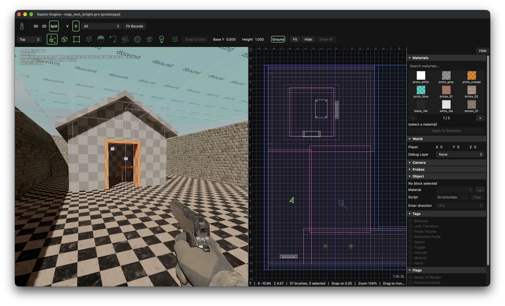
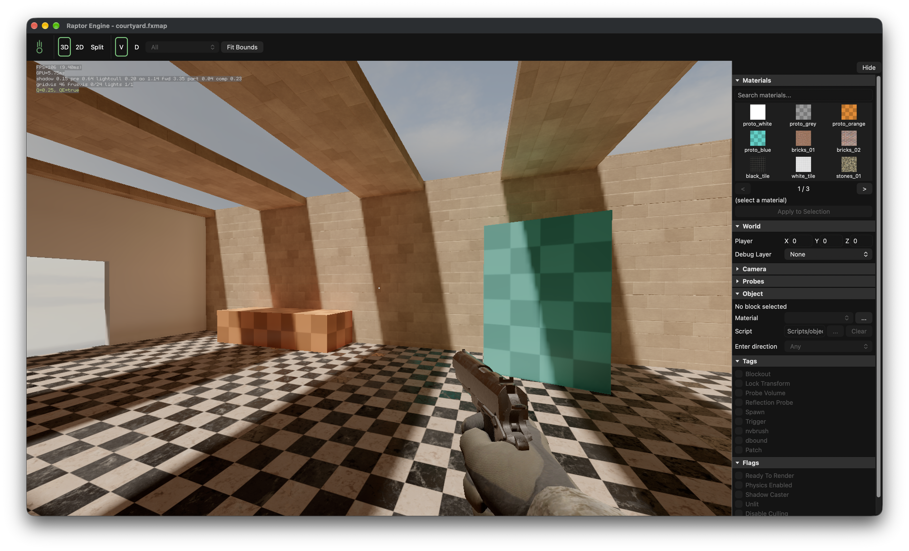

Raptor is a 3D game engine being developed for an experimental game. It features a full brush and patch system (with map compilation!) to build out levels quickly and optimize geometry.

## Screenshots

|            Integrated Level Builder             |    Global Illumination and Baked Shadows    |
| :---------------------------------------------: | :-----------------------------------------: |
|  |  |

## Features

- Tiled forward renderer (Forward+) with Vulkan
- Full level editor with game view and 2D architect view
    - supports brushes and mesh patches
- Map compilation with baked shadows and polygon/face discard
- Baked irradiance and reflection probes
- Fast math library using SIMD
    - Supports Arm NEON and AVX processors
- Scripting with [Strata](https://github.com/StrataLanguage/stratac), compiled JIT
- Custom core library and containers
- Multithreaded and extensible asset manager that works seamlessly in the background
- Jolt Physics integration

## Docs

| Name          | Document                                |
| ------------- | --------------------------------------- |
| Config format | [ConfigFormat.md](Docs/ConfigFormat.md) |

## Building

_Note: I would not recommend using this engine for your own game. This is designed specifically for my purposes and the game I am working on, and most of the game-specific assets and scripts are private. This respository is public to use as a learning tool and give back to the community that I have learned so much from._

### Building for MacOS

You can use `cmake` to generate the project files. To build with Ninja, you use one of the generated build targets.
For example,

```
# Generate the project or build files
cmake -GNinja -DUSE_SIMDE=Off -DUSE_MOLTENVK=On .

# Build Raptor
ninja

# Run the executable. Replace `Debug` with the optimization level you built with.
./build/Debug/raptor
```

## Platforms Supported

- Windows (x86_64)
- macOS (aarch64)
