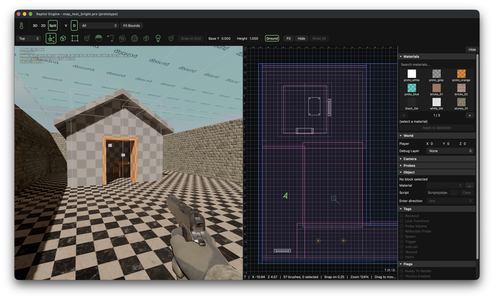
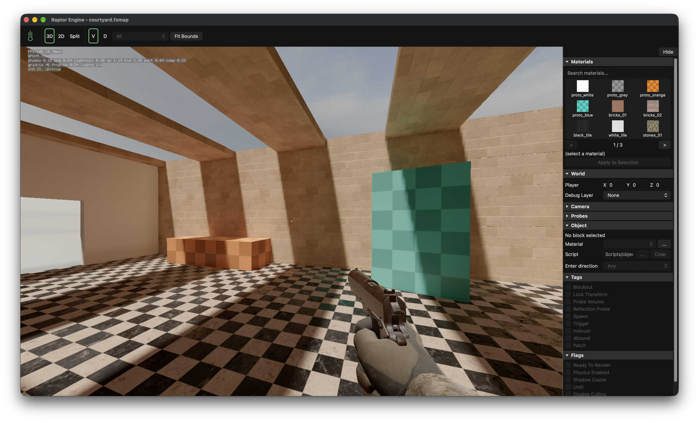

## Screenshots

|            Integrated Level Builder             |    Global Illumination and Baked Shadows    |
| :---------------------------------------------: | :-----------------------------------------: |
|  |  |

## Features

- Tiled forward renderer (Forward+) with Vulkan
- Full level editor with game view and 2D architect view
    - supports brushes and mesh patches, triangulated at map compile time.
- Custom active ragdoll system with procedural reactions
- Map compiler tool with GUI frontend.
    - Optimizes and combines brushes and patches into map chunks. Removes occluded faces and combines touching objects together.
    - Baked irradiance through lightmaps and irradiance probes
- Fast math library using SIMD
    - Supports Arm NEON and AVX feature sets. Note that for x64, the engine requires AVX or higher.
- Scripting with [Strata](https://github.com/StrataLanguage/stratac), compiled JIT
- Custom core library and containers
- Multithreaded and extensible asset manager that works seamlessly in the background

## Docs

| Name          | Document                                |
| ------------- | --------------------------------------- |
| Config format | [ConfigFormat.md](Docs/ConfigFormat.md) |
| Maps          | [Maps.md](Docs/Maps.md)                 |

## Building

_Note: I would not recommend using this engine for your own game. This is designed specifically for my purposes and the game I am working on, and most of the game-specific assets and scripts are private. This respository is public to use as a learning tool and give back to the community that I have learned so much from._

### Building for MacOS

You can use `cmake` to generate the project files. To build with Ninja, you use one of the generated build targets.
For example,

```
# Generate the project or build files
cmake -GNinja -DUSE_SIMDE=Off -DUSE_MOLTENVK=On .

# Build Raptor
ninja

# Run the executable. Replace `Debug` with the optimization level you built with.
./build/Debug/raptor
```

## Platforms Supported

- Windows (x86_64)
- macOS (aarch64)

## Third Party

I would like to thank the contributors and maintainers for these excellent libraries!

| Name                 | License           | Link                                                            | Usage                                                                              |
| -------------------- | ----------------- | --------------------------------------------------------------- | ---------------------------------------------------------------------------------- |
| Jolt Physics         | MIT               | [repo link](https://github.com/jrouwe/joltphysics)              | Realtime physics                                                                   |
| miniaudio            | Public Domain     | [repo link](https://github.com/mackron/miniaudio)               | Audio system IO and file loading                                                   |
| steam-audio          | Apache 2.0        | [repo link](https://github.com/ValveSoftware/steam-audio)       | Spatial audio                                                                      |
| libktx               | Apache 2.0        | [repo link](https://github.com/khronosgroup/ktx-software)       | Load KTX2 files as required by the asset pipeline. (TODO: add asset pipeline docs) |
| cgltf                | MIT               | [repo link](https://github.com/jkuhlmann/cgltf)                 | GLTF model loader                                                                  |
| libdeflate           | MIT               | [repo link](https://github.com/ebiggers/libdeflate)             | Compiled map and lightmap data compression                                         |
| dxc                  | LLVM              | [repo link](https://github.com/microsoft/directxshadercompiler) | Shader compiler                                                                    |
| wxWidgets (optional) | wxWidgets License | [repo link](https://github.com/wxWidgets/wxWidgets)             | Used in tools and the editor UI                                                    |
